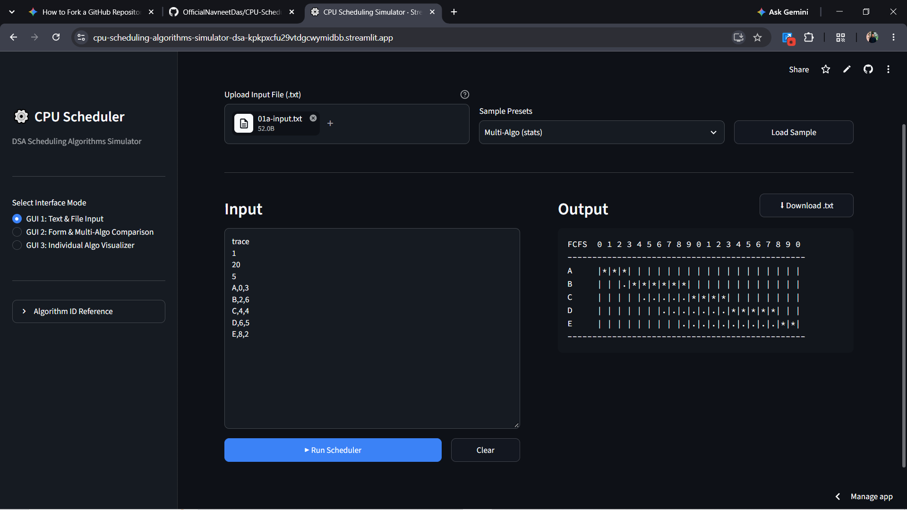
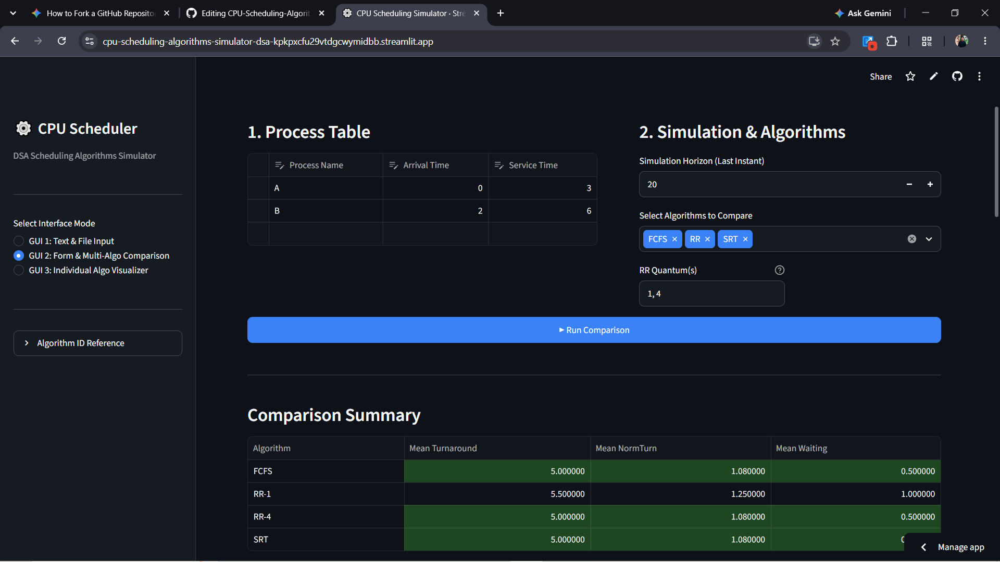
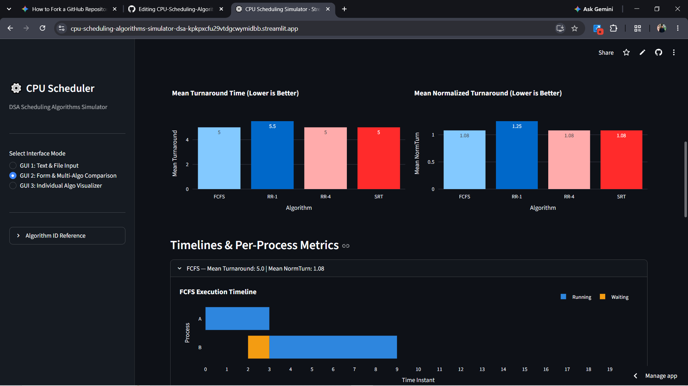
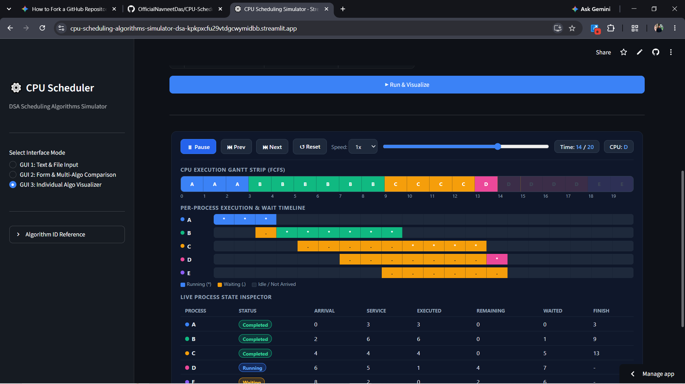

# ⚙️ CPU Scheduling Algorithms Simulator (DSA)

[](https://your-app-url.streamlit.app/)

🚀 **Live Demo:** [Launch CPU Scheduling Simulator](https://your-app-url.streamlit.app/)

An interactive web-based CPU Scheduling Simulator built with **Python**, **Streamlit**, and **Plotly**. It wraps a core Data Structures & Algorithms (DSA) scheduling engine with three distinct user interfaces for CLI-compatible testing, multi-algorithm benchmarking, and real-time step-by-step visualization.

---

## 📸 Screenshots

### 1. Text & File Input Mode (CLI-Compatible Trace & Stats)


### 2. Multi-Algorithm Comparison & Gantt Charts



### 3. Individual Algorithm Visualizer (60 FPS Playback)


---

## 🧠 Supported Scheduling Algorithms

| ID | Algorithm | Full Name | Preemptive | Quantum Support |
| :--- | :--- | :--- | :---: | :---: |
| `1` | **FCFS** | First Come First Serve | No | — |
| `2-<q>` | **RR** | Round Robin | Yes | Yes (e.g., `2-1`, `2-4`) |
| `3` | **SPN** | Shortest Process Next | No | — |
| `4` | **SRT** | Shortest Remaining Time | Yes | — |
| `5` | **HRRN** | Highest Response Ratio Next | No | — |
| `6` | **FB-1** | Feedback ($q = 1$) | Yes | Fixed ($q = 1$) |
| `7` | **FB-2i** | Feedback ($q = 2^i$) | Yes | Exponential ($2^i$) |
| `8-<q>` | **Aging** | Priority Aging | Yes | Yes (e.g., `8-1`) |

---

## 🖥️ Interface Modes

1. **GUI 1 — Text & File Input:** Paste raw problem input or upload `.txt` test files to generate exact ASCII `trace` timelines and `stats` tables with one-click `.txt` download.
2. **GUI 2 — Form & Multi-Algorithm Comparison:** Add/edit processes in an interactive table or import a `.txt` file, select multiple algorithms or comma-separated quantum variants (e.g., `1, 4`), and compare Mean Turnaround, Normalized Turnaround, Waiting Time, and Plotly Gantt charts side-by-side.
3. **GUI 3 — Individual Algorithm Visualizer:** Animate a single algorithm tick-by-tick with Play/Pause, 0.5x–4x playback speed, timeline scrubbing, a single-row CPU Gantt strip, and a live process state inspector.

---

## 📂 Project Structure

```text
CPU-Scheduling-Algorithms-simulator-DSA/
├── .streamlit/
│   └── config.toml               # Default dark theme configuration
├── assets/
│   ├── gui1.png                  # Screenshot for GUI 1
│   ├── gui2.png                  # Screenshot for GUI 2
│   └── gui3.png                  # Screenshot for GUI 3
├── views/
│   ├── __init__.py
│   ├── gui_raw_io.py             # GUI 1: Raw text/file I/O
│   ├── gui_multi_compare.py      # GUI 2: Multi-algorithm comparison
│   └── gui_single_visualizer.py  # GUI 3: Step-by-step visualizer
├── app.py                        # Main Streamlit entrypoint
├── main.py                       # Core Scheduler engine
├── parser.py                     # Input parser & validation
├── requirements.txt              # Python dependencies
└── README.md

# 🛠️ Run Locally
git clone [https://github.com/OfficialNavneetDas/CPU-Scheduling-Algorithms-simulator-DSA.git](https://github.com/OfficialNavneetDas/CPU-Scheduling-Algorithms-simulator-DSA.git)
cd CPU-Scheduling-Algorithms-simulator-DSA
pip install -r requirements.txt
streamlit run app.py

### Quick Checklist to Push Screenshots
1. Take screenshots of **GUI 1**, **GUI 2**, and **GUI 3** from your live deployed app.
2. Save them inside `assets/` as `gui1.png`, `gui2.png`, and `gui3.png`.
3. Replace `[https://your-app-url.streamlit.app/](https://your-app-url.streamlit.app/)` in `README.md` with your actual Streamlit Cloud URL, then commit and push:
   ```bash
   git add assets README.md
   git commit -m "Update README with screenshots and live Streamlit link"
   git push origin main